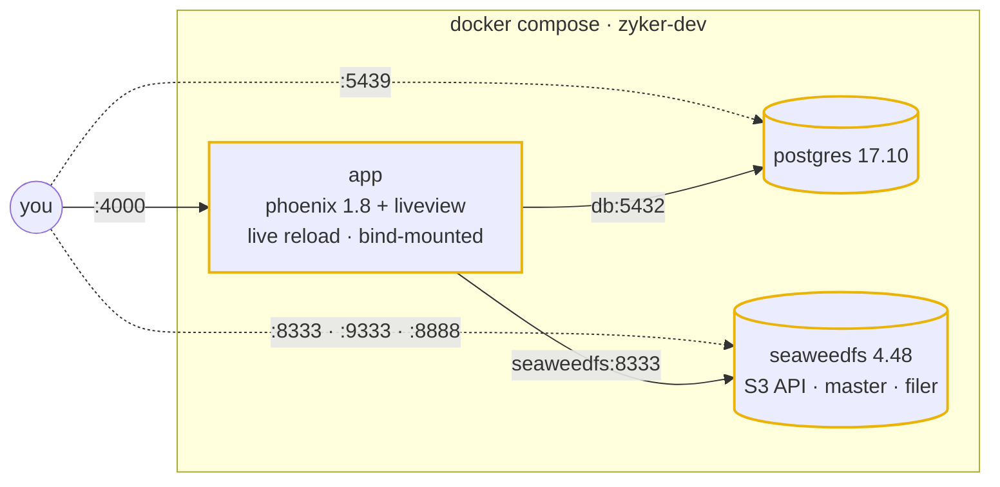

<div align="center">


**`zyker.dev`** — the control plane for your team's AI SDLC.

*self-host it, point a daemon at it from any unix box, ship.*

<br>

[](https://github.com/evedes/zyker/actions/workflows/ci.yaml)


</div>

---

## `> what it is`

zyker is a control plane that teams host to run code through their whole AI software development
lifecycle, from the first idea to shipped code, with every step recorded and gated.

Execution happens wherever the code lives. **[zyker-daemon](https://github.com/evedes/zyker-daemon)**
ships alongside zyker: start it on any unix machine (a laptop, a VM, a CI runner, a box in your
own network) and it connects to the control plane and runs the work there.

| piece          | role                                                         |
|----------------|--------------------------------------------------------------|
| `zyker`        | the control plane: teams, work, gates, history. this repo    |
| `zyker-daemon` | the executor: launches the flow on any unix machine          |
| `zyker.dev`    | the hosted instance, for teams that would rather not run it  |

> **status:** early. The foundation (stack, UI kit, extension points, CI) is in place; the
> control plane itself is being built now, in the open.

---

## `> boot sequence`

```sh
cp .env.example .env      # once · adapt ports + credentials to your machine
bin/dev up -d --build     # app + postgres + seaweedfs, all containerized
open http://127.0.0.1:4000
```

No Elixir on your host. No Postgres on your host. Just Docker and a terminal.

`bin/dev` is a thin wrapper around `docker compose -f docker-compose-dev.yaml`: it refuses to run
without `.env`, then passes everything through.

```sh
bin/dev logs -f app                              # tail the app
bin/dev exec app iex -S mix                      # shell into the running system
bin/dev exec -e MIX_ENV=test app mix test        # run the suite
bin/dev exec app mix precommit                   # warnings-as-errors · format · tests
bin/dev down                                     # power off
```

---

## `> topology`



Every port binds to `127.0.0.1` and every value lives in `.env`:

| node        | from your machine                 | knobs                                                  |
|-------------|-----------------------------------|--------------------------------------------------------|
| `app`       | http://127.0.0.1:4000             | `APP_PORT`                                             |
| `db`        | `127.0.0.1:5439`                  | `DB_PORT` · `POSTGRES_USER` · `POSTGRES_PASSWORD` · `POSTGRES_DB` |
| `seaweedfs` | http://127.0.0.1:8333 (S3)        | `S3_PORT` · `S3_ACCESS_KEY_ID` · `S3_SECRET_ACCESS_KEY` · `S3_BUCKET` |
|             | http://127.0.0.1:9333 · `:8888`   | `SEAWEEDFS_MASTER_PORT` · `SEAWEEDFS_FILER_PORT`       |

Source is bind-mounted into the container, so saves hot-reload. `deps` and `_build` live in named
volumes.

---

## `> interface`

A component library written in HEEx, with no React in sight.

- **looks like** [shadcn/ui](https://ui.shadcn.com): the same neutral tokens, variants and quiet confidence
- **built like** [Base UI](https://base-ui.com): `data-slot` on every part, state as `data-*` / ARIA,
  labels and errors wired with `aria-describedby`
- **pure** Tailwind v4: no daisyUI and no CSS framework, just semantic tokens with a `.dark` twin

```heex
<.button variant="outline" size="sm" phx-click="deploy">
  <.icon name="hero-bolt-mini" /> Ship it
</.button>

<.input field={@form[:email]} type="email" label="Email" description="We never share it." />
```

Every component and variant is rendered live at **`/dev/ui`** (dev only), dark-mode toggle included.
The components themselves live in `lib/zyker_web/components/ui/`.

---

## `> extending`

Build on zyker without forking it: make your own Phoenix app, add zyker as a Mix dependency and
mount it. zyker keeps owning the repo, the endpoint and its routes; your app adds pages next to them.

```elixir
# mix.exs
{:zyker, github: "evedes/zyker", branch: "main"}

# config/config.exs: zyker's endpoint serves your router, and your static files before zyker's
config :zyker, :web, router: MyAppWeb.Router, static_apps: [:my_app, :zyker]
```

```elixir
defmodule MyAppWeb.Router do
  use ZykerWeb, :router
  require ZykerWeb.Routes

  ZykerWeb.Routes.pipelines()      # :browser, :api

  scope "/", MyAppWeb do
    pipe_through :browser
    get "/pricing", PricingController, :show   # yours come first, so they win
  end

  ZykerWeb.Routes.routes()         # everything zyker serves
end
```

A dependency's `config/*.exs` is never loaded, so your app configures `:zyker` itself (repo,
endpoint, mailer). For assets, import zyker's `assets/css/app.css` and `assets/js/app.js` from your
own, and set `MIX_DEPS_PATH` to your deps folder for the heroicons plugin.
`test/support/host_app.ex` is a minimal host that the test suite keeps working.

---

## `> agent-native`

This repo is written to be read by humans *and* models.

| file                    | signal                                                            |
|-------------------------|-------------------------------------------------------------------|
| `AGENTS.md`             | the house rules: stack, dev loop, UI conventions, pre-commit ritual |
| `CLAUDE.md`             | one line, `@AGENTS.md`, so Claude Code loads the rules on boot    |
| `PHOENIX_GUIDELINES.md` | generic Phoenix 1.8 wisdom; read before touching Elixir           |

Point your agent at the repo and it already knows the way around.

---

## `> license`

[AGPL-3.0](LICENSE). Self-host it freely; if you run a modified zyker as a service, share your
changes under the same license.

---

<div align="center">

<sub>zyker.dev · made by <a href="https://github.com/evedes">@evedes</a></sub>

🇵🇹 &nbsp; 🇪🇺

</div>
